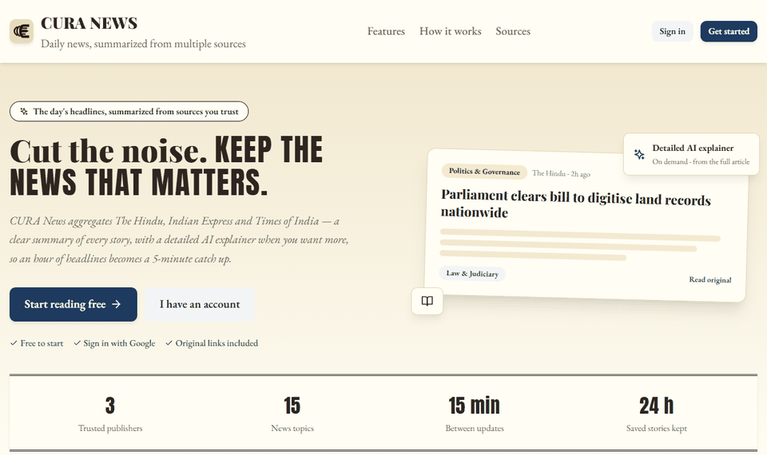
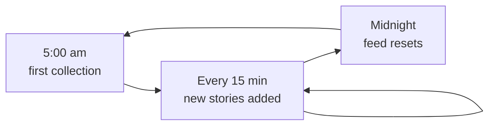
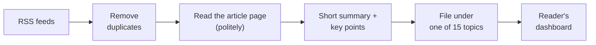
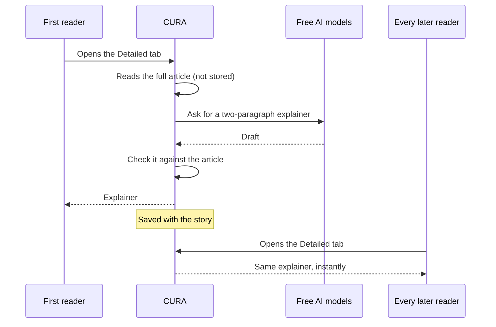

<p align="center">
  
</p>

<p align="center">
  <b>Today's news from three trusted papers, summarized so you can catch up in minutes.</b><br />
  <a href="https://cura-news.vercel.app/">Live site</a>
</p>

<p align="center">
  
</p>

---

## What it is

CURA News brings **The Hindu**, **The Indian Express** and **The Times of India**
into one calm feed. Every story opens with a short summary and a few key points
taken from what the publisher reported. If a story interests you, open its
**detailed explainer**: two short paragraphs written by AI from the full article.
Every story links back to the original.

The feed holds **today's news only**. It fills up from 5 am, refreshes every 15
minutes, and starts clean again at midnight.

## What a reader can do

- **Pick your papers and topics.** After signing up, a short animated setup asks
  which papers and topics you care about. The **For You** tab then shows only
  those; **Latest** shows everything.
- **Browse 15 topics,** from Politics and Economy to Sports and Science, and
  combine them with search and paper filters.
- **Read your way:** a compact line view grouped by paper, or a card view.
- **Go deeper on demand** with the detailed explainer, and have it **read aloud**,
  with each paragraph highlighted as it is spoken.
- **Save stories for 24 hours.** Saved stories survive the midnight reset.
- **Sign in with email or Google,** change your picks any time in Settings, and
  delete your account permanently.
- Small touches: local weather in the header, a header that slides away while you
  scroll down, and a "Detailed" badge on stories that already have an explainer.

## How it works

### A day in the feed



Every 15 minutes between 5 am and midnight (India time), CURA checks 27 RSS feeds
across the three papers' sections. It drops stories it already has, then adds up
to 20 new ones, newest first, with the papers taking turns so no single paper
crowds the feed. Anything left over is picked up on the next round. At midnight
the feed is cleared so each morning starts fresh.

### From headline to summary



The **short summary uses no AI**. CURA reads each article page once and uses the
publisher's own words: the page's description, or the RSS description, or the
article's opening sentences, or the headline, whichever is first usable. Key
points are the most informative remaining sentences. Junk like "View this post on
Instagram", cut-off sentences and stray quote fragments is filtered out.

Pages are read the way a good citizen of the web should: `robots.txt` is honoured,
requests are spaced out, and a site that keeps failing is left alone for that
round.

### The detailed explainer: made once, shared with everyone



Explainers are written **only when someone asks**. The first reader to open a
story's Detailed tab triggers one; it is saved with the story, so every later
reader gets it instantly, and the story gets a "Detailed" badge on everyone's
feed. Stories nobody opens never use any AI.

Before an explainer is shown, CURA checks it:

- It must be two paragraphs of roughly 100 words. A long answer is trimmed at a
  sentence break rather than thrown away.
- It must be in its own words: not copied from the article, and not repeating
  the short summary or key points.
- It must not mention **numbers the article never states**, a common way AI
  makes things up.

A draft that fails a check gets one rewrite before CURA gives up on it.

If the article page is too thin or paywalled, CURA says so instead of guessing.

### Staying free

All of the AI runs on **free tiers**. Instead of relying on one model, CURA keeps
a pool of nine free models from two providers (Groq and Google Gemini). Each has
its own small allowance, so CURA tracks every model separately, waits when a
provider asks it to, and moves on to the next model when one is busy. Readers
waiting on an explainer always go first.

In testing on live articles, an explainer used about 1,400 tokens, and the pool
can write roughly **1,350 explainers a day**. That is enough for nearly every
story the feed can collect in a day.

## Built with

React and Vite on the front, Node.js and Express on the back, MongoDB for
storage. Hosted on Vercel (site), Render (server) and MongoDB Atlas (database).
90 server tests run the real API against an in-memory database (Node's built-in
test runner), and 39 website tests cover the dashboard, landing page and components
(Vitest and Testing Library). GitHub Actions runs both, plus a production
build, on every push and pull request.

## Run it locally

You need Node.js 22+, MongoDB (local or a free Atlas cluster), and a free API key
from Groq and/or Google AI Studio.

```bash
# server: http://localhost:5000
cd backend
npm install
cp .env.example .env     # add your MongoDB address and AI keys
npm run dev
```

```bash
# website: http://localhost:3000
cd frontend
npm install
cp .env.example .env
npm run dev
```

Run the tests with `npm test` in `backend` or `frontend`. The server tests
start their own in-memory MongoDB, so no database install is needed.

<details>
<summary><b>Configuration</b></summary>

Server settings live in `backend/.env`; every setting and its default is
documented in [`backend/src/config/env.js`](backend/src/config/env.js). The ones
you are most likely to change:

| Setting | What it does |
| --- | --- |
| `MONGO_URI` | Database address |
| `JWT_SECRET` | Signs login tokens; at least 32 characters in production |
| `GROQ_API_KEY`, `GEMINI_API_KEY` | AI keys; one is enough |
| `AI_PROVIDER` | Which provider's models to try first: `gemini` or `groq` |
| `GROQ_MODELS`, `GEMINI_MODELS` | Your own model list; empty uses the built-in free models |
| `GOOGLE_CLIENT_ID` | Enables Google sign-in; empty hides it |
| `CORS_ORIGIN` | The website's address |
| `INGEST_INTERVAL_MINUTES`, `INGEST_MAX_PER_RUN` | How often to collect stories, and how many to add each time (15 and 20) |
| `AI_DAILY_LIMIT` | Most explainers per day (2000) |

The website needs `VITE_API_BASE_URL` (the server's address ending in `/api`)
and, for Google sign-in, `VITE_GOOGLE_CLIENT_ID`.

Feeds are listed in [`backend/src/config/feeds.js`](backend/src/config/feeds.js)
and topics in [`backend/src/config/topics.js`](backend/src/config/topics.js).
`npm run feeds:check` reports whether each feed is healthy.

</details>

<details>
<summary><b>Deploying</b></summary>

1. **Database:** create a MongoDB Atlas cluster and a database user, and allow
   connections from Render (`0.0.0.0/0` is the simple option).
2. **Server on Render:** New → Blueprint, pick this repo. [`render.yaml`](render.yaml)
   sets up the service and generates `JWT_SECRET` and `CRON_SECRET`. Fill in
   `MONGO_URI`, `CORS_ORIGIN` (your Vercel address, no trailing slash), your AI
   keys, and `GOOGLE_CLIENT_ID` if you use Google sign-in.
3. **Website on Vercel:** import the repo with `frontend` as the root directory,
   and set `VITE_API_BASE_URL` and `VITE_GOOGLE_CLIENT_ID`.
4. **Google sign-in:** add the Vercel address to the OAuth client's authorized
   JavaScript origins.

Run the server as **one instance on a plan that never sleeps**. The 15-minute
collection, the midnight reset and the AI pacing all run inside it.

</details>

<details>
<summary><b>API at a glance</b></summary>

All routes start with `/api`. 🔒 means a login token is required.

| Route | Purpose |
| --- | --- |
| `POST /auth/register`, `/auth/login`, `/auth/google` | Sign up or sign in |
| `GET /news` | Today's stories, with search, topic and paper filters |
| `GET /news/for-you` 🔒 | Today's stories from your picked papers and topics |
| `GET /news/:id` | One story |
| `POST /news/:id/detailed` 🔒 | The detailed explainer, from the cache or freshly written |
| `GET /news/stats/overview` | Today's counts, including how many explainers exist |
| `/bookmarks` 🔒 | Save, list and remove stories (kept 24 hours) |
| `/me/preferences` 🔒 | Read or change your picks |
| `DELETE /me` 🔒 | Permanently delete your account |

</details>
